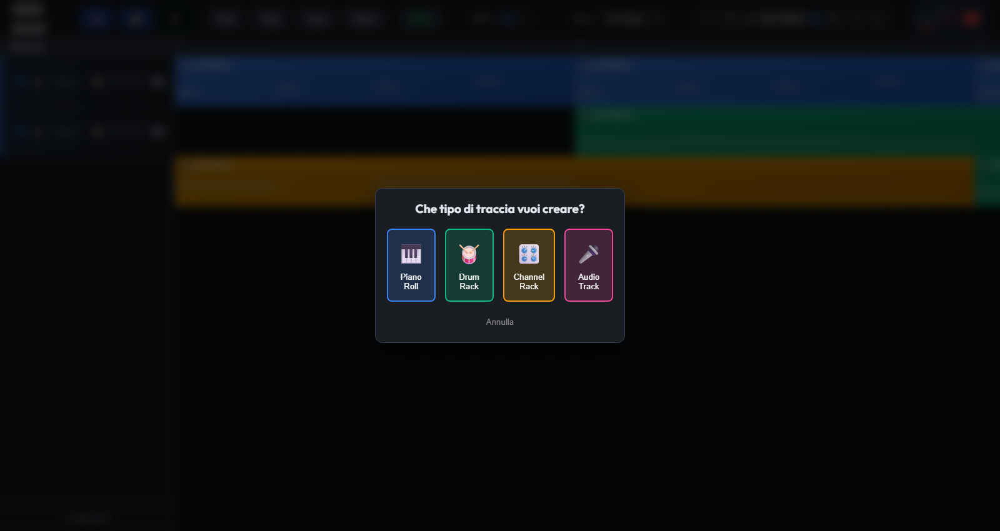
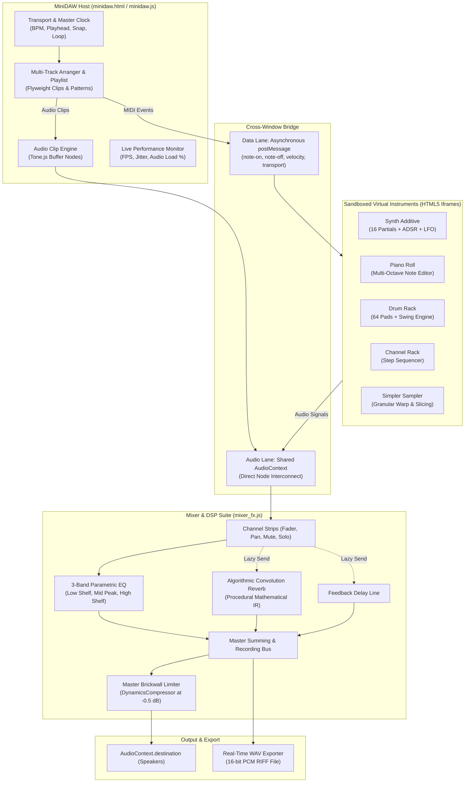

# Web Audio MiniDAW

> **A Modular, Framework-less Web Audio Digital Audio Workstation**

[](https://developer.mozilla.org/en-US/docs/Web/API/Web_Audio_API)
[](https://tonejs.github.io/)
[](https://developer.mozilla.org)
[](https://developer.mozilla.org)
[](https://developer.mozilla.org)

<p align="center">
  
</p>

---

## 🎧 Overview

**MiniDAW** is a fully client-side, browser-native Digital Audio Workstation built from the ground up using **Vanilla JavaScript**, the native **Web Audio API**, and **Tone.js**. Designed around a modular, zero-framework micro-frontend architecture, MiniDAW isolates individual virtual instruments inside sandboxed `<iframe>` environments and communicates in real time via an asynchronous, bidirectional `postMessage` protocol.

The system combines:
- A non-linear multi-track timeline arranger with sub-tick precision playhead tracking.
- An FL-Studio-inspired multi-octave Piano Roll.
- A 16-partial additive synthesizer with harmonic partial sliders, 17 presets, ADSR envelopes, filters, and dual LFO modulation.
- A 64-pad programmable Drum Rack with micro-timing swing.
- A classic Channel Rack step sequencer.
- A granular time-stretching 1-shot sampler (*Simpler*) with waveform slicing and zero-crossing detection.
- A full-featured mixing console featuring per-track 3-band parametric EQs, algorithmic convolution reverb, feedback delay, dynamic master limiting, and real-time canvas visualizers.
- Pure JavaScript 16-bit stereo WAV export and JSON project serialization (`.mindaw`).

---

## 🏛️ System Architecture



### 1. Zero-Configuration Sandboxing & Co-Tenancy
Monolithic web applications suffer from global namespace collisions and single-point-of-failure vulnerabilities: if an instrument encounters an uncaught exception, the entire host crashes. MiniDAW eliminates this by running each instrument inside an isolated `<iframe>` container. Each instrument maintains its own state and lifecycle while securely interacting with the host DAW through a cross-window bridge.

### 2. Dual-Lane Cross-Window Communication Bridge
Communication between the host thread and instrument iframes is bifurcated:
* **The Data Lane (Control):** Operates over the HTML5 `postMessage` protocol. Control instructions (`note-on`, `note-off`, `stop-all`, MIDI note index, velocity, playhead updates) are dispatched asynchronously without blocking the main rendering loop.
* **The Audio Lane (Signal):** All modules share access to the host's `masterAudioCtx` via a secure property pass (`window.masterAudioCtx`). Audio nodes connect directly into the mixer's gain junctions, bypassing inter-process memory serialization and ensuring true sample-accurate DSP performance.

### 3. Non-Linear Flyweight Data Model: Patterns vs. Clips
To support massive musical arrangements without memory bloat, MiniDAW decouples musical notes from timeline clips:
* **Pattern:** The data container housing the musical notes and step triggers.
* **Clip:** A lightweight pointer instance referencing a `patternId`, an absolute `startStep`, and a display duration.
Duplicating a 16-bar drum beat 100 times across the timeline instantiates 100 minuscule pointer references rather than duplicating 1,600 note objects in memory.

### 4. Hybrid Playback Routing
During each clock tick, the playback engine dynamically determines the clip modality:
* **MIDI Clips:** Dispatched over the Data Lane (`postMessage`) to trigger instrument voices.
* **Audio Clips:** Decoded audio buffers scheduled directly onto the timeline via `Tone.js` audio nodes and rendered onto the playlist with real-time waveform graphics.

---

## 🎹 Sound Engines & Virtual Instruments

### 1. 🎛️ Additive Synthesizer (`Synth Additive`)
A harmonic sound design synthesizer based on Fourier theorem summation:
- **16 Harmonic Partials:** Individual faders controlling the fundamental and 15 upper harmonics.
- **17 Curated Presets:** *Sine, Sawtooth, Square, Triangle, Organ, Bell, Brass, Flute, Strings, Clarinet, Choir, Pluck, Bass, Vintage, Nasal, Hollow, Clear*.
- **ADSR Envelope Generator:** Dedicated Attack, Decay, Sustain, and Release controls with an interactive **live Canvas visualizer**.
- **Multi-Mode Filter:** Biquad filter supporting *Lowpass, Highpass, Bandpass, and Notch* topologies with cutoff (20 Hz - 20,000 Hz) and resonance ($Q$).
- **Dual Modulation Engine:**
  - *Vibrato:* LFO modulating oscillator frequencies (0.1 Hz – 15 Hz, 0 – 100% depth).
  - *Tremolo:* LFO modulating voice amplitude (0.1 Hz – 15 Hz, 0 – 100% depth).
- **Voice Allocation:** Polyphonic voice tracking using a FIFO key registry.

### 2. 🎼 Piano Roll Editor
An FL-Studio-style MIDI sequencing environment:
- Multi-octave chromatic keyboard with mouse and keyboard auditioning.
- Intuitive note creation, drag-to-resize, multi-note selection, duplication, and deletion.
- Musical grid quantization: 1/4 (Beat), 1/8, 1/16 (Step), 1/32, 1/3 (Triplet), and 1/6 (Triplet).
- Target track assignment allowing any pattern to be routed to any mixer channel.

### 3. 🥁 Drum Rack
A dedicated rhythmic step-sequencing unit:
- Configurable matrix supporting **4 to 64 pads** with dynamic grouping (1–16).
- **Micro-Timing Swing Engine:** Humanized groove generator supporting 1/16 and 1/8 swing with adjustable percentage depth (0–100%).
- **Per-Pad FX Send:** Individual Reverb and Delay wet amounts for each drum element.

### 4. 📻 Simpler (Granular Pitch-Shifting & Warp Sampler)
A creative sampling workstation:
- Drag-and-drop audio file ingestion (`.wav`, `.mp3`, `.ogg`, `.flac`).
- Interactive waveform visualizer with draggable start/end trim markers and fade-out handle.
- **Granular Time-Stretching & Warp:** Powered by `Tone.GrainPlayer`, decoupling playback speed from pitch so imported loops stay rhythmically synchronized when changing project BPM.
- ADSR envelope shaping and loop toggle.
- Chromatic playback across computer keys (`A, W, S, E, D, F...`) with octave shifting (`Z/X`).

### 5. 🎚️ Channel Rack
A lightweight step sequencer ideal for fast groove sketches, pattern experimentation, and multi-track rhythmic layering.

---

## 🎛️ Mixing Console & DSP Effects Suite (`mixer_fx.js`)

MiniDAW incorporates a multi-channel mixing console designed for optimal audio fidelity and CPU conservation:

```
[ Track Input ] 
       │
       ▼
 [ 3-Band Parametric EQ ] ───► [ Stereo Panner ] ───► [ Downstream Volume Fader ] ───► [ Master Limiter ] ──► [ Output ]
                                       │                              │
                                       ├──► [ Lazy Reverb ] ──────────┤
                                       └──► [ Lazy Delay ] ───────────┘
```

* **Dual-Gain Architecture:** An initial zero-gain summing junction handles voice summing while shielding internal nodes from plugins. A downstream volume fader cuts all audio post-effects, ensuring instantaneous track muting without residual reverb spillover.
* **3-Band Parametric Equalizer:**
  * **Low Band:** Low-shelf filter (20 Hz – 1,000 Hz, $\pm 24\text{ dB}$).
  * **Mid Band:** Peaking bandpass filter (200 Hz – 8,000 Hz, $Q = 0.1\text{ to }10$, $\pm 24\text{ dB}$).
  * **High Band:** High-shelf filter (1,000 Hz – 20,000 Hz, $\pm 24\text{ dB}$).
  * **Interactive Canvas Curve:** Real-time visual curve overlay plotting filter transfer functions across the frequency spectrum.
* **Algorithmic Convolution Reverb:** Procedurally generates a custom 2.5-second impulse response buffer using an exponential mathematical decay function:
  $$h[n] = \text{random}(-1, 1) \cdot \left(1 - \frac{n}{N}\right)^3$$
* **Feedback Delay Line:** Synchronized time delay with feedback saturation and wet/dry attenuation.
* **Lazy Node Allocation & CPU Optimization:** Convolution reverb and delay nodes are instantiated lazily and completely disconnected from the Web Audio graph when their respective wet sends are set to zero. This frees the browser from computing unnecessary FFT convolutions during playback.
* **Master Brickwall Limiter:** A dedicated `DynamicsCompressorNode` inserted right before the master output ($Threshold = -0.5\text{ dBFS}$, $Ratio = 20:1$, $Knee = 0.0$, $Attack = 5\text{ ms}$, $Release = 50\text{ ms}$) prevents digital clipping and inter-sample distortion when multiple voices sum.
* **Real-Time Telemetry:** Continuous time-domain peak detectors (VU meters) and frequency-domain FFT spectrum analysers.

---

## 💾 Project Management & Audio Export

### 1. Lightweight Project Serialization (`.mindaw`)
Instead of packing gigabytes of redundant binary data into Base64 strings, MiniDAW serializes project state into lightweight JSON structures containing metadata, pattern arrays, clip coordinates, mixer states, and volume values. Legacy Base64 audio projects remain supported for backward compatibility.

### 2. Intelligent Missing Audio Relinking Engine
When opening a project containing external audio stems, MiniDAW detects missing audio buffers and opens a relinking dialog. Users simply select the directory where their audio files reside; the engine traverses the directory tree and re-attaches missing files by filename matching automatically.

### 3. Real-Time Master Audio Bounce (WAV Exporter)
MiniDAW includes an integrated client-side audio rendering pipeline:
- A dedicated `ScriptProcessorNode` / audio tap captures the summed 32-bit floating-point stereo audio stream from the `masterRecordingBus`.
- An in-memory JavaScript RIFF encoder converts float samples into 16-bit interleaved linear PCM bytes and prepends a standard 44-byte WAV header.
- Generates an immediate browser download link (`audio/wav`) without requiring third-party libraries or server-side rendering.

---

## ⚡ Live Performance Telemetry

The top navigation toolbar houses an active real-time performance telemetry monitor:
* **FPS Counter:** Tracks rendering frame rate using `performance.now()`.
* **Tick Jitter:** Measures millisecond deviations between the Web Audio hardware clock and JavaScript event loop ticks.
* **Audio Load Gauge:** Visual meter displaying CPU/system strain with dynamic color alerts (green $\to$ yellow $\to$ red).

---

## 🚀 Quick Start Guide

Due to browser security restrictions on cross-frame scripting and audio context loading (CORS and Web Audio Autoplay Policy), the application must be served over a local HTTP server rather than opened via `file://`.

### Prerequisites
- Any modern web browser: **Google Chrome**, **Microsoft Edge**, **Brave**, or **Firefox**.
- Python 3.x installed (or Node.js `http-server`).

### Launch Options

#### Option A: One-Click Windows Launcher
Double-click the included batch script:
```powershell
.\AVVIA_PROGETTO.bat
```
This starts a local Python HTTP server on port 5502 and opens Google Chrome in Incognito mode (ensuring a fresh, clean sandbox for all iframes).

#### Option B: Terminal / Command Line
1. Clone this repository:
   ```bash
   git clone https://github.com/gio961gio/web-audio-minidaw.git
   cd web-audio-minidaw
   ```
2. Start a local HTTP server:
   ```bash
   # Using Python 3:
   python -m http.server 5502

   # Or using Node.js:
   npx http-server -p 5502
   ```
3. Open your browser and navigate to:
   ```
   http://localhost:5502/minidaw.html
   ```

> [!TIP]
> If you experience issues with cross-iframe communication, open the URL in an **Incognito / Private Window** to prevent stale browser extensions or aggressive service workers from intercepting `postMessage` calls.

---

## ⌨️ Keyboard Shortcuts & Controls

| Key / Action | Context | Function |
| :--- | :--- | :--- |
| `Space` | Global | Play / Stop playback |
| `A, W, S, E, D, F, G, Y, H, U, J, K` | Synth / Sampler | Play chromatic keyboard notes |
| `Z` / `X` | Synth / Sampler | Shift octave down / up |
| `Left Click + Drag` | Piano Roll / Playlist | Draw notes / Move clips |
| `Right Click` | Piano Roll / Playlist | Delete note / Remove clip |
| `Snap Dropdown` | Toolbar | Switch grid quantization (1/4, 1/8, 1/16, 1/32, Triplets) |
| `BPM Input` | Toolbar | Real-time tempo adjustment (40 – 300 BPM) |

---

## 📁 Repository Structure

```
web-audio-minidaw/
├── minidaw.html                  # Main Host Application & Timeline Arranger
├── minidaw.js                    # Host logic, transport, clip engine, WAV renderer, telemetry
├── minidaw.css                   # Global styling and dark-theme layout
├── mixer_fx.js                   # Modular Mixer, 3-Band Parametric EQ, Reverb, Delay & Limiter
├── AVVIA_PROGETTO.bat            # One-click Windows development launcher
├── audio_track_/                 # Audio track mixer bridge component
│   └── audio_track_.html
├── channel_rack_/                # Step Sequencer (Channel Rack)
│   ├── channel_rack_.html
│   ├── channel_rack_.js
│   └── channel_rack_.css
├── drum_rack_/                   # 64-Pad Drum Rack with Swing Engine
│   ├── drum_rack_.html
│   ├── drum_rack_.js
│   └── drum_rack_.css
├── piano_roll_/                  # Multi-Octave Piano Roll Editor
│   ├── piano_roll_.html
│   ├── piano_roll_.js
│   └── piano_roll_.css
├── sampler_/                     # Simpler (Granular Warp Sampler)
│   ├── sampler_.html
│   ├── sampler_.js
│   └── sampler_.css
├── synth_additive_/              # 16-Harmonic Additive Synthesizer
│   ├── synth_additive_.html
│   ├── synth_additive_.js
│   └── synth_additive_.css
└── README.md                     # Documentation
```
